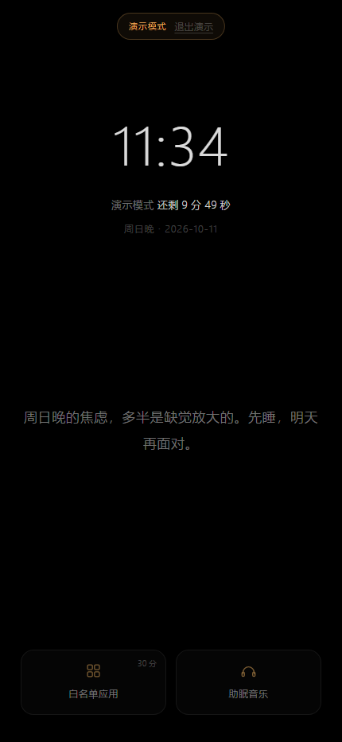
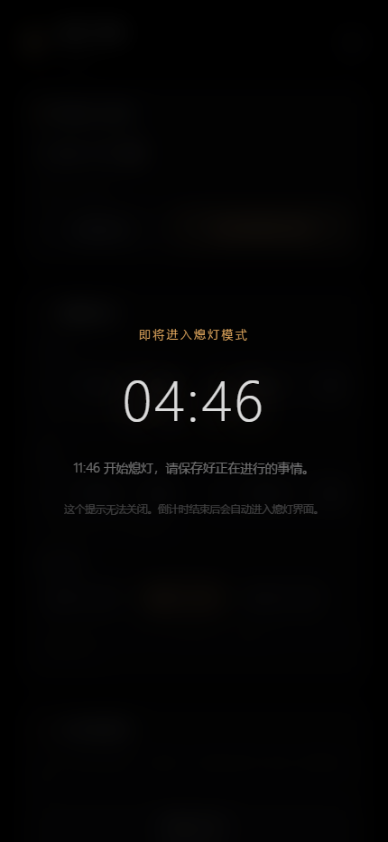
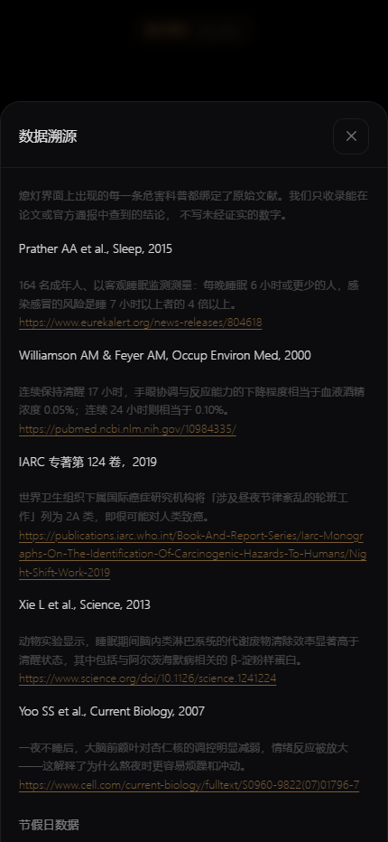
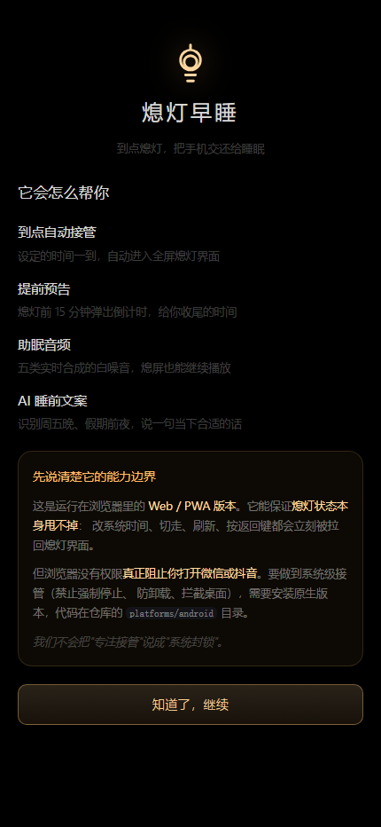

# 熄灯早睡 · Lights Out

> 到点熄灯，把手机交还给睡眠。


一款**到点自动接管设备的强制型睡眠辅助工具**。设定的熄灯时间一到，应用自动进入全屏黑屏界面，
屏蔽娱乐应用、播放助眠音频、用 AI 生成贴合当天的睡前文案，并配合每周限额的紧急解除机制，
把"想早睡但管不住自己"这件事，从**依赖意志力**变成**依赖机制**。

---

## 立即体验

| | |
| --- | --- |
| **在线使用**（无需安装） | <https://yxyusage.github.io/LightsOut/> |
| **Windows 桌面版**（日常使用推荐） | <https://github.com/yxyusage/LightsOut/releases>（`Xideng.Desktop.exe` 单文件，需 .NET 10 Desktop Runtime） |
| **下载 Android APK** | <https://github.com/yxyusage/LightsOut/releases/download/android-latest/app-debug.apk> |
| 全部发布版本 | <https://github.com/yxyusage/LightsOut/releases> |

> **在线版**：打开后点主页的「立即体验熄灯模式」，不必等到晚上 23:00。
> 手机浏览器「添加到主屏幕」后可全屏独立运行，断网也能打开。
>
> **Windows 桌面版**：真正的全屏置顶接管 + 前台进程监听 + 白名单窗口层级放行
> （熄灯时只有白名单应用可见，桌面与其他应用始终被黑屏遮住），适合电脑前日常使用。
>
> **Android 版**：debug 签名，侧载安装（不能上架商店），能做到 Web 版做不到的系统级接管。

---

## 目录

- [它解决什么问题](#它解决什么问题)
- [功能一览](#功能一览)
- [技术形态与能力边界](#技术形态与能力边界)
- [截图](#截图)
- [快速开始](#快速开始)
- [目录结构](#目录结构)
- [架构：一套核心，多个壳](#架构一套核心多个壳)
- [测试](#测试)
- [设计决策](#设计决策)
- [隐私](#隐私)
- [路线图](#路线图)
- [许可](#许可)

---

## 它解决什么问题

| 痛点 | 现状 | 熄灯早睡的做法 |
| --- | --- | --- |
| 知道熬夜有害，但行为上停不下来 | 科普文章看完就忘 | 到点直接接管屏幕，**不给临场决策的机会** |
| 普通睡眠 App 只会提醒 | 提醒可以被随手划掉、忽略 | 全屏接管 + 防绕过守卫，**关不掉、甩不掉** |
| 缺外部约束，越睡越晚 | 纯靠自律，必然失败 | 每周 2 次解除额度，**把"破戒"变成有成本的稀缺资源** |
| 睡前刷手机停不下来 | 无止境的信息流 | 白名单 + 总时长上限，**给娱乐一个明确的预算** |

目标用户：18–30 岁、有早睡意愿但自控力较弱、长期受熬夜困扰的学生与职场新人。

---

## 功能一览

对照 `docs/reference/熄灯早睡产品需求文档-V1.0.docx` 逐条实现：

### 睡眠计划管理（PRD 2.1）
- 工作日 / 周末**两套独立**熄灯时段，精确到分钟，**支持跨天**（23:00 → 次日 07:00）
- 一键开启 / 关闭计划
- 提前预告：可选 10 / 15 / 30 分钟，全屏半透明弹窗 + 精确读秒，**不可关闭**
- 每周 **2 次**紧急解除额度，**自然周周一 00:00** 自动重置

### 强制熄灯模式（PRD 2.2）
- 到点自动进入，播放**拉灯绳灭灯**入场动画（1.5 秒）后转入全屏黑屏界面
- 黑屏界面：实时时间、距离熄灯结束的剩余时长、轮播文案、底部功能入口
- 白名单应用：系统电话 / 短信默认加入、**不可移除、不占时长**；自定义应用共用一个总时长池，**上限 60 分钟**
- 紧急解除：**连续点击 5 次** → 输入密码 → 消耗 1 次周额度；解除后本次熄灯失效，次日按计划自动恢复

### 助眠音频（PRD 2.3）
- 五类音色：**雨声 / 溪流声 / 海浪声 / 篝火声 / 纯白噪音**
- **全部用 Web Audio API 实时合成** —— 零音频素材、零版权风险、无限循环无接缝
- 播放时长可选 15 / 30 / 60 分钟或持续到熄灯结束，支持独立音量调节

### AI 场景化文案（PRD 2.4）
- **基础模式**：内置文案库，含可溯源的熬夜危害数据与情绪安抚语句
- **AI 增强模式**：填入自己的 OpenAI 兼容 API Key 后，识别**周五晚 / 周六晚 / 周日晚 / 假期前夜 / 假期最后一晚 / 调休上班日晚**等场景生成个性化文案
- 未配置 Key 时**功能完全不受影响**，自动使用内置文案库

### 防绕过防护体系（PRD 三）
- 系统时间篡改检测（改时间会被立即拉回，且**不重置剩余时长**）
- 后台切换拦截、刷新与返回键拦截
- 屏幕唤醒锁、离线可用（Service Worker 预缓存）

---

## 技术形态与能力边界

> 这一节是刻意写在前面的。**我们不会把"专注接管"说成"系统封锁"。**

本仓库包含三个端的实现，能力各不相同：

| 端 | 目录 | 技术栈 | 能否真正阻止你打开微信/抖音 | 验证状态 |
| --- | --- | --- | --- | --- |
| **Web / PWA** | `apps/web` | 原生 ES Module | ❌ 不能 | ✅ 已端到端验证（单测 / 静态检查 / 无头浏览器渲染 / 交互链路 / 离线预缓存） |
| **桌面端（Windows）** | `platforms/desktop` | Avalonia 11 + .NET 10 | ✅ 可以（真全屏置顶 + 前台进程监听 + 白名单窗口层级放行） | ✅ Windows 已实现，266 项自测通过；macOS 待实现 |
| **Android** | `platforms/android` | Kotlin + AndroidX | ✅ 可以（设备管理员 + 无障碍服务 + 前台服务 + 防卸载） | ✅ **GitHub Actions 已成功构建 Debug APK**，可直接下载安装 |

> 开发用的那台机器上没有 Android SDK、且 Maven Central 不可达，所以编译这件事**交给了 CI**
> —— GitHub Actions 的 runner 自带 JDK 与 Android SDK。首次真正编译时暴露了 3 个错误，均已修复。
>
> **仍未验证的是「真机运行」**：APK 没有在实体设备上装过，无障碍服务、设备管理员这些
> 系统级能力只有真机能验。这是目前最明确的一块空白，我们照实标出来。

**Web / PWA 版能保证的是**：熄灯状态本身甩不掉 —— 改系统时间、切走再回来、刷新页面、按返回键，
都会被立刻拉回熄灯界面；断网也能进入熄灯界面。

**Web / PWA 版做不到的是**：浏览器沙箱内没有任何 API 可以阻止用户切换到其它 App。
要做到系统级接管（禁止强制停止、防卸载、拦截 HOME 键），必须使用原生端。

Web 版给出的等效体验是：**「添加到主屏幕」后以 standalone 模式全屏独立运行**，
配合唤醒锁与全屏接管，仪式感与强制感保留度很高。

---

## 截图

| 熄灯黑屏界面 | 主页与睡眠计划 |
| --- | --- |
|  |  |

| 助眠音频 | 白名单应用 |
| --- | --- |
|  |  |

| 提前预告（不可关闭） | 数据溯源 |
| --- | --- |
|  |  |

| 首次引导（含能力边界说明） | 紧急解除 |
| --- | --- |
|  |  |

> 截图由无头 Chrome 实际渲染产生，不是设计稿。

---

## 快速开始

### 环境要求

只需要 **Node.js ≥ 18**。**没有任何 npm 依赖**，不需要 `npm install`。

### 本地运行（电脑）

```bash
git clone <你的仓库地址>
cd xideng

# 启动本地静态服务器
node scripts/serve.mjs
```

然后在浏览器打开 <http://127.0.0.1:5180/>。服务器启动时会打印所有可用地址：

```
  电脑上打开：
    http://127.0.0.1:5180/

  手机上打开（需与电脑连同一个 Wi-Fi）：
    http://192.168.1.23:5180/        （WLAN）
```

> 直接双击 `apps/web/index.html` 也能看到界面，但 `file://` 下 Service Worker 与
> 「添加到主屏幕」不可用，因此**开发时请走本地服务器**。

### 在手机上预览

服务器默认绑定 `0.0.0.0`，同一 Wi-Fi 下的手机可以直接访问。

1. 确认手机与电脑连的是**同一个 Wi-Fi**；
2. 在手机浏览器输入启动时打印的那个局域网地址（形如 `http://192.168.1.23:5180/`）；
3. 打开后点「**立即体验熄灯模式**」——不必等到晚上 23:00 就能看到熄灯界面。

**如果手机打不开**，几乎一定是 **Windows 防火墙**拦住了。先看一下当前网络类别：

```powershell
Get-NetConnectionProfile | Select-Object InterfaceAlias, NetworkCategory
```

然后在**以管理员身份运行**的 PowerShell 里放行这一个端口。
**注意要用 `-Profile Any`**：只写 `-Profile Private` 在「公用网络」下**不会生效**，
而连接手机热点时通常就是公用网络。

```powershell
New-NetFirewallRule -DisplayName "熄灯早睡 本地预览 5180" -Direction Inbound -Protocol TCP -LocalPort 5180 -Action Allow -Profile Any
```

用完后想删掉：

```powershell
Remove-NetFirewallRule -DisplayName "熄灯早睡 本地预览 5180"
```

> **手机上 PWA 能力的限制**：局域网 `http://192.168.x.x` 属于**不安全上下文**，
> 浏览器会拒绝注册 Service Worker 与 Wake Lock。因此手机上界面与熄灯功能完全正常，
> 但「**离线可用**」与「**安装为应用**」这两项用不了 —— 它们需要 HTTPS。
> 要完整体验 PWA，请先部署到公网（见 [docs/DEPLOY.md](docs/DEPLOY.md)），
> 那里有 GitHub Pages 的一次性配置方案，免费且稳定。

### 构建发布产物

```bash
node scripts/build.mjs     # 输出到 dist/
node scripts/serve.mjs dist
```

`dist/` 是一个**完全自包含的静态站点**（约 440 KB），把它整个目录上传到任意静态托管
（GitHub Pages / Vercel / Netlify / 对象存储 / Nginx）即可获得公网可访问的 URL。

部署细节见 [docs/DEPLOY.md](docs/DEPLOY.md)；
把仓库发布到 GitHub、开启 Pages、拿到公网 URL，见 [docs/PUBLISH-GITHUB.md](docs/PUBLISH-GITHUB.md)。

### 安装 Windows 桌面版（推荐日常使用）

单文件 `Xideng.Desktop.exe` 从 [Releases 页面](https://github.com/yxyusage/LightsOut/releases) 下载后直接运行：

- 需要 **.NET 10 Desktop Runtime**（首次运行提示缺运行时时，到微软官网安装即可）
- 功能：到点全屏黑屏接管（每屏一个窗口）、拉绳仪式（60 秒不拉自动熄灭）、
  助眠白噪音（雨 / 海浪 / 溪流）、白名单智能添加（从运行中的应用点选或浏览 .exe，上限 3 个）
  与共用时长预算（按熄灯窗口重置，耗尽强制拉回）、紧急解除（每周 2 次）、改时间检测
- 设置界面为选项卡布局，时间用「时 / 分滚轮 + 键盘直输」，适配 14 寸笔记本
- 验证：内置自检（`Xideng.Desktop.exe --selftest`，266 项断言）

### 安装 Android 端（可选）

Android 端是唯一能做到**系统级接管**的形态（设备管理员防卸载、无障碍服务拦截前台应用）。
Debug APK 由 GitHub Actions 在每次构建成功时自动发布，**无需登录即可下载**：

```
https://github.com/yxyusage/LightsOut/releases/download/android-latest/app-debug.apk
```

也可以从 [Releases 页面](https://github.com/yxyusage/LightsOut/releases) 或
[Actions 的构建产物](https://github.com/yxyusage/LightsOut/actions/workflows/build-android.yml) 获取。

> 这是 **debug 签名**的包，**不能上架应用商店**，只能侧载安装。
> 安装后需要在系统设置里逐项授予无障碍、设备管理员、悬浮窗、电池优化白名单等权限，
> 具体清单与厂商 ROM 的注意事项见 [platforms/android/README.md](platforms/android/README.md)。

### 跑测试

```bash
npm test        # 等价于 node --test（自动发现 tests/ 下的用例）
```

### 重新生成图标与封面

```bash
python scripts/make-assets.py
```

需要 Python 3 + Pillow + numpy（仅用于生成本地素材，运行应用时不需要）。

---

## 目录结构

```
.
├── apps/web/                    Web / PWA 应用（零依赖、零构建）
│   ├── index.html               应用外壳（含全部界面的静态结构）
│   ├── manifest.webmanifest     PWA 清单
│   ├── sw.js                    Service Worker（离线预缓存）
│   ├── styles/app.css           全部样式（设计令牌 + 各界面）
│   ├── assets/                  应用图标与社交预览图
│   └── src/
│       ├── core.js              ★ 指向 packages/core 的唯一引用点
│       ├── app.js               编排层：相位控制、守卫、动作
│       ├── lib/                 DOM 工具、拉灯绳动画控制
│       └── views/               各界面模块
├── packages/core/               平台无关核心（纯 ESM，可在 Node 中测试）
│   └── src/
│       ├── time.js              时间与日期基础工具（纯函数，不读系统时间）
│       ├── holidays.js          2026 年法定节假日与调休数据（含出处）
│       ├── schedule.js          睡眠计划与相位判定（跨天时段）
│       ├── scene.js             场景识别（周五晚 / 假期前夜 / …）
│       ├── copy.js              文案库与轮播（危害科普均绑定文献来源）
│       ├── quota.js             每周解除额度
│       ├── whitelist.js         白名单时长预算
│       ├── password.js          紧急解除密码
│       ├── ai.js                OpenAI 兼容客户端 + 降级
│       ├── audio.js             Web Audio 白噪音合成
│       ├── guard.js             防绕过守卫
│       ├── settings.js          设置读写与版本迁移
│       └── engine.js            状态引擎（组合以上全部）
├── platforms/                   原生端
│   ├── desktop/                 Windows / macOS（Avalonia + .NET）
│   └── android/                 Android（Kotlin）
├── scripts/                     build / serve / 素材生成
├── tests/                       Node 内置测试运行器
├── docs/                        文档与设计决策
└── .github/                     CI 与协作模板
```

---

## 架构：一套核心，多个壳

```
                    ┌──────────────────────────────┐
                    │      packages/core           │
                    │  「什么时间算熄灯、额度怎么扣、  │
                    │    文案怎么挑、音频怎么合成」    │
                    │  纯 ESM · 无 DOM · 无依赖      │
                    └───────────────┬──────────────┘
                                    │
        ┌───────────────────────────┼───────────────────────────┐
        │                           │                           │
   ┌────▼─────┐              ┌──────▼──────┐            ┌───────▼──────┐
   │ apps/web │              │  desktop    │            │   android    │
   │  PWA     │              │ Avalonia    │            │   Kotlin     │
   │          │              │ + C# 移植    │            │ + assets/wh  │
   └──────────┘              └─────────────┘            └──────────────┘
   零依赖 / 离线可用            全屏置顶 + 进程监听          设备管理员 + 无障碍
```

**关键设计约束**：`packages/core` 里的所有函数都是纯函数，**从不读取系统当前时间**——
当前时间一律由调用方注入。这样带来三个好处：

1. 熄灯判定可以在单元测试里任意"穿越时间"验证（测试里 23:59 → 00:00 的跨周重置就是这么测的）；
2. 同一份逻辑可以被 Web、桌面、Android 三端复用，不会出现"Web 上 23:00 熄灯、桌面上 23:05 熄灯"；
3. 桌面端与 Android 端可以用各自的语言**镜像移植**，并以 `core` 的测试用例作为行为基准。

详见 [docs/ARCHITECTURE.md](docs/ARCHITECTURE.md)。

---

## 测试

```bash
npm test
```

**127 个核心测试，全部通过**（使用 Node 内置测试运行器，零第三方依赖；桌面端另有 266 项自测）。
测试重点放在"容易写错且后果严重"的地方：

- **跨天熄灯时段的区间计算** —— 凌晨 02:00 必须归属到前一天开启的那次熄灯
- **自然周额度在周一 00:00 重置** —— 而不是简单按 7 天滚动
- **节假日日期与国务院通知中写明的星期是否一致** —— 逐日反向验证，防止抄错一天
- **紧急解除的校验顺序** —— 密码错误**不应**消耗用户宝贵的解除次数
- **白名单预算跨午夜不重置** —— 堵住"23:50 用 30 分钟、00:10 再用 30 分钟"的漏洞
- **存储损坏时的自愈** —— 任何 localStorage 异常都不能把用户锁死在熄灯界面里

---

## 验证记录

「哪些验证过、哪些没验证过」的完整记录见 [docs/VERIFICATION.md](docs/VERIFICATION.md)，
包括 127 项核心单测、静态检查、无头 Chrome 渲染与交互链路测试、离线预缓存验证、
桌面端 266 项自测，以及一份诚实的**未验证清单**。

## 设计决策

PRD 中存在若干处需要判断的地方，我们的处理方式与理由记录在
[docs/DECISIONS.md](docs/DECISIONS.md)，包括：

- **PRD 2.2.3「当日」的歧义**：字面按日历日重置，但熄灯时段 23:00→07:00 横跨午夜，
  0 点重置会在同一次熄灯中间白送 30 分钟额度。我们改为**按熄灯时段计费**，两种行为都有测试覆盖。
- **PRD 2.2.3「共用总时长」与「电话短信无时长限制」的冲突**：电话/短信标记为不占额度。
- **调休上班日的归类**：法定调休把周六变成上班日时，当晚按**工作日**时段熄灯。
- **危害科普的真实性**：每条科普都绑定可核查的文献来源，界面上可一键展开溯源。
  **没有一条数据是编造的** —— 睡眠类产品最容易出现随口编造的吓人数字，我们宁可少写。

---

## 隐私

- 所有设置、密码摘要、使用记录**只写入本机** localStorage，不上传任何服务器
- 配置 AI 后，请求**直接发往你自己填写的接口地址**，不经过任何中转；API Key 只存在本机
- 提示词中**只包含结构化场景事实**（日期、星期、节假日），不包含任何个人数据
- 没有任何统计、埋点或崩溃上报

---

## 路线图

见 [docs/ROADMAP.md](docs/ROADMAP.md)。V1.0 之后计划中的方向包括睡眠数据统计、
早睡打卡奖励、小憩模式、睡眠健康分析与好友对比。

---

## 贡献

欢迎提 Issue 与 PR，请先阅读 [CONTRIBUTING.md](CONTRIBUTING.md)。
参与本项目即表示同意遵守 [行为准则](CODE_OF_CONDUCT.md)。

---

## 许可

[MIT License](LICENSE) © 2026 熄灯早睡 contributors

本项目为独立开发作品，与任何第三方厂商无隶属关系。内置的熬夜危害科普数据均标注了原始文献出处。
